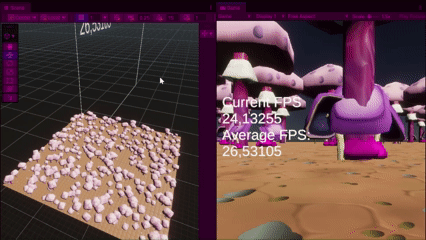
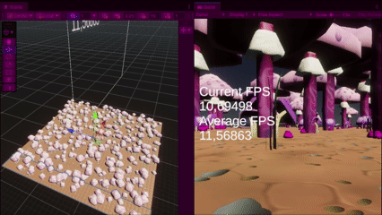

# Multithreading test case

## Introduction
In this project I want to learn how to use multithreading to optimize algorithms. I want to show this by applying my knowledge to a procedural generation algorithm that I made in a group project. I will use unity’s jobs system to speed up the algorithm.

Most programs run on one thread. This means that all instructions happen one after the other. Modern CPU’s have multiple cores. These cores can execute instructions separately at the same time. Using multiple cores for one program is a challenge, as logic happening out of order can corrupt the data. When using multiple cores you can separate the logic into threads. Each thread runs on a different core in the CPU. It’s important to design your code in such a way that each thread can work independent of each other. The program is created on one core. This program is called the main thread. The program then creates new threads that are run on different cores. Each thread communicates with the main thread to share the fruit of their labor. Unity provides a jobs system, which manages this communication.

## Copy the project and setup testing environment
I started by copying the project, so I could work on it without changing the original version. I added three new scenes in a special folder where I could compare different algorithms. I made one scene for the original generation system, which would be used as a baseline measurement. I added a scene for the double threaded implementation, where the whole algorithm would be moved to a separate thread, eliminating all the work on the main thread. The last scene is for the many threaded implementation, where each chunk is generated on a separate thread. This implementation would generate faster than the double threaded version. In these scenes I added the scripts needed to generate terrain and a canvas to display FPS both of that frame and the average of the last 10 frames. 

I set the code up so that the chunk generation resets every time it is completed. This makes measurements more consistent, as the generation runs all the time, not just in startup. At the start of the game there are other things getting initiated, which creates a bit of lag. Measurements 

## Read unity documentation on the jobs system
After reading the unity documentation I realized I had a few problems that forced me to rethink my approach. The first problem is that object instantiation is only possible on the main thread. After doing a bit of profiling I found out that instantiation takes up almost all of the processing time. This would mean that even if I implement multithreading perfectly I would only see a small performance improvement.

In the image below you can see the profiler while generating terrain. The big blue boxes represent the  whole algorithm as it runs that frame. The green boxes are objects being instantiated, while the red boxes are data being deleted. The small blue boxes are debug prints which happen between chunks getting generated. As you can see there is very little space between chunks getting generated. This means that multithreading won’t help optimizing this algorithm.

[picture here]

I realized that the time complexity of my generation logic scales with the number of possible placements likely with some exponent, while object spawning scales with the number of actual placements, which is limited by the settings. By increasing the size of the chunks I could slow down the main algorithm enough that a significant amount of time would pass between chunks getting generated. This would make the benefit of multithreading measurable.

I ended up deciding to keep the chunk size the same while lowering the HexScale value. This has the same effect of increasing the number of possible placements, while keeping the size of the chunks the same. This made it easier to keep using the same assets. The objects just end up placed closer together.

In the picture below you can see the profiler while generating terrain with HexScale at 1x1 instead of 5x5. This means that there are 25 times as many possible spawning spaces and 5x as many pathfinding checks that run about 5 times as long. This means that the logic runs a lot slower, without effecting the time it takes to spawn objects. The blue box is the whole algorithm as it runs that frame. The backlog of chunks to be generated remains full between frames, so the coroutine never restarts, which is why there is only one big blue box instead of the two in the previous picture. The green spaces are objects being instantiated, while the red spaces are data being deleted. The blue boxes are debug prints, which happen between chunks getting generated. As you can see there is a lot of space between chunks getting generated. This space in between can be optimized with multithreading.

[picture here]

To be clear, this is the same algorithm running the same code. The only change is the setting for how the chunks are laid out. The settings we used for the group project were optimized for looks and gameplay purposes. The algorithm I made at the time worked great for the requirements we had at the time. It’s only when you change the requirements, pushing the system to it’s limits that you can see the system slow down.

The second problem is that basic data structures are not supported when using the Jobs system. Equivalent data structures are available, but they need to be converted properly. This ruins my plan of converting my existing algorithms, because that would make debugging almost impossible. All data structures need to be viable for the code to run. I decided to start from scratch in a new script. Here I could test small algorithms and build them up as I go. I can copy and paste chunks of code, adapt them then test them until the algorithm is complete. This takes a lot more time then my initial plan.

Given the new approach of spawning objects on the main thread, there is not much of a point in having a double threaded implementation. Instantiation still has to be done on the main thread, slowing it down anyway. I decided to skip straight to the many threaded approach to save time.

## Experiment with multithreading example code
I started by copying example code into my project. I have a script with a scheduling class that schedules the job and a script with a job struct that represents the job. The job struct has to inherit from IJob to use the jobs system. The struct contains an Execute() method, which contains the actual code that the job runs. The job struct contains a NativeArray used to return the result. This is an array that lives in a stable place in memory. Both the scheduling class and the job struct have a reference to this location, so they can both access it. A stable memory location also means that all reference types such as classes, lists and dictionaries are forbidden.

First the scheduling class makes the job struct and the array. The scheduling class shares the array with the job struct and schedules the job. This activates the Execute() method on a different thread, which writes to the array. The scheduling class then tests if the code is done and activates the Complete() method. This makes the array usable to the scheduling class and ends the job. The array still exists in the scheduling class, which can use the data and then dispose it to free the memory. This is how the example code works.

[picture here]

## Connect multithreading to terrain generation systems
In my procedural generation code I have a script that works at a chunk level and a script that works at the level of the whole terrain. The class that works at the terrain level calls an event that activates a method in the chunk level class called GenerateTerrain(). This method activates the chunk generation algorithm. Once this algorithm is complete and all objects in that chunk have been spawned the method ends and the terrain level class activates the event again for the next chunk. This logic happens inside a coroutine, with a yield return that gets activated when too much time has passed. I implemented this logic so that the lag caused by the algorithm gets spread across multiple frames. This is the part I wanted to replace with the double threaded system, but that is not going to work. instead I went down to the chunk level class and put that on a separate thread.

I added the GenerateTerrain() method to the scheduling class and connected the event. I set it up such that every time the GenerateTerrain() method is called the job is also scheduled and completed. I added a print statement to display the result array to test this connection. I then added an iteration counter as an input for the job, so that the print statement outputs the iteration count.

Here is the result:

[picture here]

This showed me that chunks were getting scheduled, but not all of them. This is because I added a stopgap meant to prevent the result array from getting overwritten during generation. When the GenerateTerrain() method gets called it checks if there is a job running or not. The numbers are all multiples of 121. This is because the whole terrain is 121 chunks. That is 11x11 chunks. There are 3 frames between the first generation and the first reset. Then another 2 frames per reset every print.

This means that the connection with the generation system is made, and works in a predictable way. Instead of solving the issue right away I wanted to get object spawning working with this one chunk first.

## Generate first game objects using multithreading
To spawn objects using procedural generation I added a method that spawns the objects using the data in the result array. I already had a method like this, but it took the data directly out of the pathfinding data structure. This data structure is built as a reference type, with structs that contain lists of structs and a dictionary of those. I disentangled that datastructure and designed a new data structure of NativeArrays and NativeLists and NativeDictionaries where the index in the structure maps different structures together. It’s a bit of a mess, but it does follow all of the rules. The result array stores the objects that have been spawned as an integer. The index maps to a position and the value maps to a game object. By writing to the result array I can spawn an object at a certain place using the object spawning method. After a lot of testing and tinkering I got this to work.

I then copied over the first major method of the generation algorithm. This method picks a bunch of positions randomly out of all the options and spawns objects there. The rules of this algorithm are interesting and complex, but not worth going into in depth. Once I finally had this working I was able to spawn my first chunk using multithreading.

[picture here]

## Generate multiple chunks using multithreading
That’s right my first chunk. Remember the stopgap from earlier? It’s time to fix that now.

I made a new script with a GenerationRequest class. This class keeps track of everything that is relevant to a specific chunk getting generated. It stores the game object that the instantiated objects are the child of, the job struct, the result array and other native data structures. In the GenerateChunk method I can create the GenerationRequest and put it in a list. Then in Update I can loop through the list and check which jobs are done. I can then complete the job, activate the object spawning method using that result array and dispose the data. This structure keeps the chunk generation data separate and organized. This then allows me to generate all the chunks properly.

[picture here]

## Optimizing multithreading bottlenecks
Now that all the chunks are getting generated a lot of new performance issues are revealed. Every time that the generation resets there is a major lag spike that lasts a few frames, but takes up a few seconds. Then after this lag spike all the chunks are getting generated very quickly at which point the system resets again. This means that the code is constantly resetting leading to permanent lagspikes. The first thing I did is slow down the request completion loop. I added a return to the loop to make the loop only generate one chunk per frame. This slowed down the generation enough to see that the lag spike happens at the beginning.

Show screenshot of the profiler with physics slowing the main thread.

The profiler shows that during the lag spike, physics is taking up most of the time on the main thread. I analyzed the profiler a bit deeper and found out that there is another task on a separate thread that takes up the same amount of time. I realized that the physics system is actually waiting on a job to finish, which is stuck in the jobs queue, because it’s already full with MY jobs. I added some logic in the terrain level code to only schedule jobs when there is enough space free. I use system info to get the number of cores that the device has, to calculate how many of my jobs can safely run at the same time. The coroutine continuously schedules new jobs every frame to keep the cores working without blocking any other job.

Show screenshot of the profiler with physics taking almost no time on the main thread.

This fixed the lag spikes, but also lowered the per chunk speed boost. It used to be that the jobs would all be done in the first few frames. The frames after were really fast, as the code only had to read the result arrays and instantiate objects to generate a chunk. This is the speed boost I am talking about. Now that the job scheduling is limited, the physics isn’t getting blocked. This means that the framerate at the beginning is up. This also means that it takes many frames to schedule all the chunks. The object spawning is now somewhat bottlenecked by the job scheduling each frame, which means that the perceived speed boost is gone. This results in a smooth framerate, as the jobs scheduling and objects spawning both take up roughly the same time each frame. The only time where the framerate is irregular is during a reset, because all the existing chunks need to be destroyed, which takes about 50 milliseconds(0.05 seconds). This is a significant but acceptable lag spike.

Show screenshot of the resetting spike

## Complete generation algorithm
You would think the project would be done here, but no. this is only the obstacle generation part of the algorithm. I still needed to add the pathfinding algorithm to test if there is a valid path from the start of the chunk to the end of the chunk. If the pathfinding fails the generation needs to be redone creating a loop that ends when a viable path is reached. This took a bit of time and tinkering, but I got it to work. I then also added the coin generation and grass generation code. These objects aren’t obstacles, so they are done after the pathfinding algorithm. This took a lot of time without a big difference in result, but I can’t fairly compare the old algorithm with the new one if both algorithms don’t do the same thing. That would be comparing apples to oranges or pears. There’s not much more to say other than I got a lot of practice in.

## Results
This is the best part. Here are some screenshots of the profiler and some gifs that show the algorithm in action.

Gifs comparing the results here

The terrain generates faster, while the FPS goes from around 15 FPS to around 55 FPS. This performance boost comes from moving the calculation to worker threads, leaving the main thread with only object spawning and some job scheduling time. The FPS sits around the same number as the old system using the higher hex scale value. This makes sense, as that version also spent most of it’s time instantiating objects. That is ultimately the bottleneck which multithreading can’t get around.

